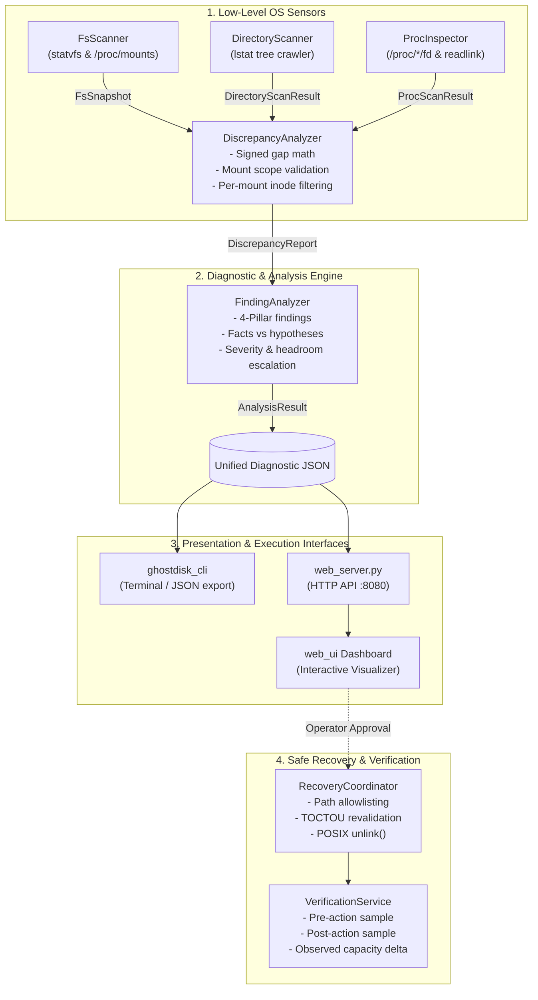

# GhostDisk: Evidence-Based Linux Storage Diagnosis & Safe Recovery

> A Linux-first systems utility and diagnostic suite to investigate storage discrepancies, detect process-held `deleted-but-open` file leaks, perform discrepancy accounting, execute allowlisted safe recovery, and verify reclaimed space with post-action telemetry.

---

## Table of Contents
1. [System Architecture & Data Flow](#1-system-architecture--data-flow)
2. [Complete Technology Stack](#2-complete-technology-stack)
3. [Deep-Dive Module Specifications](#3-deep-dive-module-specifications)
   - [3.1 OS Capacity Telemetry (`FsScanner`)](#31-os-capacity-telemetry-fsscanner)
   - [3.2 Directory Crawler & Size Accounting (`DirectoryScanner`)](#32-directory-crawler--size-accounting-directoryscanner)
   - [3.3 Process & Open-File Detective (`ProcInspector`)](#33-process--open-file-detective-procinspector)
   - [3.4 Discrepancy & Finding Analysis Engine (`DiscrepancyAnalyzer` & `FindingAnalyzer`)](#34-discrepancy--finding-analysis-engine-discrepancyanalyzer--findinganalyzer)
   - [3.5 Safe Recovery Coordinator & Verification (`RecoveryCoordinator` & `VerificationService`)](#35-safe-recovery-coordinator--verification-recoverycoordinator--verificationservice)
   - [3.6 Standalone CLI Application (`ghostdisk_cli`)](#36-standalone-cli-application-ghostdisk_cli)
   - [3.7 Web Dashboard & Live Server (`web_server.py` & `web_ui`)](#37-web-dashboard--live-server-web_serverpy--web_ui)
4. [Mathematical & Operating System Formulas](#4-mathematical--operating-system-formulas)
5. [Safety Invariants & Non-Goals](#5-safety-invariants--non-goals)
6. [Controlled Test Suite (T1 – T9)](#6-controlled-test-suite-t1--t9)
7. [Build & Execution Guide](#7-build--execution-guide)

---

## 1. System Architecture & Data Flow

GhostDisk connects low-level Linux kernel measurements directly to an evidence-backed diagnosis, conservative recovery, and verified outcome.



---

## 2. Complete Technology Stack

| Layer | Technologies & Standards | APIs, Syscalls & Libraries | Purpose |
| :--- | :--- | :--- | :--- |
| **Core Systems Language** | **C++17** (`-std=c++17 -Wall -Wextra -Wpedantic`) | POSIX.1-2008, STL (`<chrono>`, `<atomic>`, `<map>`, `<vector>`) | High-performance, memory-safe, zero-overhead OS inspection. |
| **Filesystem Telemetry** | Linux VFS / ext4 / btrfs / xfs | `statvfs()`, `struct statvfs` | Reads total, raw free, user-available, and block dimensions. |
| **Mount Discovery** | Linux Virtual Filesystem | `/proc/mounts`, `/etc/mtab`, `std::ifstream` | Discovers mounted partitions while filtering pseudo-filesystems. |
| **Directory Traversal** | POSIX Directory Streams | `opendir()`, `readdir()`, `closedir()`, `lstat()`, `struct stat` | Symlink-safe recursion, apparent size vs. allocated block calculation. |
| **Process Inspection** | Linux `/proc` pseudo-filesystem | `/proc/<pid>/fd/`, `readlink()`, `fstat()`, `open(O_CLOEXEC)` | Detects unlinked open file descriptors holding disk blocks. |
| **Path & Allowlist Safety** | POSIX File Security | `realpath()`, `lstat()`, `unlink()`, `S_ISLNK`, `st_ino`, `st_dev` | TOCTOU race mitigation, strict allowlist confinement, zero shell calls. |
| **Build System** | **CMake 3.16+** | `CMakeLists.txt`, `ctest` | Multi-target compilation, testing orchestration, warning enforcement. |
| **Live Web Server** | **Python 3.8+** | `http.server`, `subprocess`, `urllib.parse`, `json`, `pathlib` | Zero-dependency local REST API and asset server (`:8080`). |
| **Web Dashboard** | **Vanilla HTML5, CSS3, ES6 JS** | CSS Custom Properties, SVG, Fetch API | Lightweight, modern dark-themed interactive diagnostic visualizer. |

---

## 3. Deep-Dive Module Specifications

### 3.1 OS Capacity Telemetry (`FsScanner`)
- **Headers & Source**: [`include/ghostdisk/fs_scanner.hpp`](include/ghostdisk/fs_scanner.hpp), [`src/fs_scanner.cpp`](src/fs_scanner.cpp)
- **Primary Function**: `FsSnapshot scan_mount(const std::string& target_path)`
  - **API Call**: `::statvfs(target_path.c_str(), &vfs)`
  - **Mechanisms**:
    - Queries Virtual Filesystem Switch (VFS) metrics via `struct statvfs`.
    - Handles variable fundamental block sizes: uses `f_frsize` (fundamental fragment size) when positive, otherwise falls back to `f_bsize`.
    - Computes user-available capacity (`f_bavail * frsize`) separately from raw free space (`f_bfree * frsize`).
    - Isolates reserved/unavailable space (`raw_free - available`) rather than hard-coding a 5% ext4 assumption.
- **Mount Discovery**: `std::vector<MountInfo> discover_mounts(bool include_pseudo_fs)`
  - Reads `/proc/mounts` line-by-line.
  - Dynamically filters out virtual/pseudo filesystems: `proc`, `sysfs`, `devpts`, `cgroup`, `cgroup2`, `pstore`, `bpf`, `autofs`, `tracefs`, `hugetlbfs`, `mqueue`, `debugfs`, `securityfs`, `fusectl`, `configfs`, `ramfs`.
- **String Formatting**: `std::string format_bytes(uint64_t bytes)`
  - Converts raw byte values into human-readable strings (`B`, `KB`, `MB`, `GB`, `TB`) using binary powers ($1024^n$) with 2-decimal precision.

---

### 3.2 Directory Crawler & Size Accounting (`DirectoryScanner`)
- **Headers & Source**: [`include/ghostdisk/directory_scanner.hpp`](include/ghostdisk/directory_scanner.hpp), [`src/directory_scanner.cpp`](src/directory_scanner.cpp)
- **Primary Function**: `DirectoryScanResult scan(const std::string& root_path, const ScanOptions& options, const std::atomic<bool>* cancel_token, ProgressCallback progress_cb)`
- **Key Functions & Syscalls**:
  - `::lstat(full_path.c_str(), &st)`: **Critical**: Never uses `stat()`. `lstat()` reads symlink inode metadata directly without following the link target, completely eliminating infinite directory loops.
  - `::opendir(path.c_str())` & `::readdir(dir)`: Streams directory entries efficiently.
- **Apparent Size vs. Allocated Blocks**:
  - `apparent_bytes`: Retrieved directly from `st.st_size` (logical byte stream length).
  - `allocated_bytes`: Calculated as `st.st_blocks * 512ULL`. In POSIX/Linux, `st_blocks` is always allocated in 512-byte units regardless of the underlying filesystem cluster size.
  - Correctly reflects sparse files (e.g., a 100 GB VM disk image with only 4 KB allocated).
- **Mount Boundary Confinement**:
  - Checks `st.st_dev` against `root_device_id`.
  - When `options.cross_device_boundaries == false`, traversal halts at sub-mount junctions, recording them in `skipped_entries` rather than inflating scan totals.
- **Cooperative Cancellation & Progress**:
  - Periodically inspects `cancel_token->load(std::memory_order_relaxed)` to immediately abort long scans.
  - Dispatches `ScanProgress` callbacks every 100 scanned entries to drive UI progress bars without freezing the main thread.
- **Skipped Path Tracking**:
  - Intercepts `EACCES` and `EPERM` errors, recording the inaccessible directory path and error code without terminating the scan.

---

### 3.3 Process & Open-File Detective (`ProcInspector`)
- **Headers & Source**: [`include/ghostdisk/proc_inspector.hpp`](include/ghostdisk/proc_inspector.hpp), [`src/proc_inspector.cpp`](src/proc_inspector.cpp)
- **Primary Function**: `ProcScanResult scan(const ProcScanOptions& options, ...)`
- **Detailed Step-by-Step Traversal**:
  1. **PID Enumeration**: Opens `/proc` and filters entries with `is_numeric_pid()`.
  2. **Process Metadata**: Reads `/proc/<pid>/comm` for executable names and parses `/proc/<pid>/status` for UID.
  3. **Descriptor Inspection**:
     - Iterates through `/proc/<pid>/fd/`.
     - Calls `::readlink(fd_path, buffer, size)` to read symlink targets.
     - Parses the target string using `parse_deleted_target()`: matches the `" (deleted)"` suffix appended by the Linux kernel when an open file is unlinked.
  4. **Descriptor Stat Query**:
     - Attempts `open(fd_path, O_RDONLY | O_NONBLOCK | O_CLOEXEC)` followed by `fstat()` to query file identity directly through the open file table.
     - Falls back to `lstat()` on the descriptor link if opening fails.
     - Retrieves `st_dev`, `st_ino`, `st_size`, and allocated blocks ($st\_blocks \times 512$).
  5. **Inode Deduplication (`deduplicate_findings`)**:
     - When multiple processes or threads hold references to the same unlinked file, grouping is performed by `(device_id, inode)` pairs using `std::map<std::pair<uint64_t, uint64_t>, DeletedOpenFileFinding>`.
     - Prevents counting the same physical disk blocks multiple times.
  6. **Defensive Race Condition Handling**:
     - Gracefully catches transient processes and descriptors closing mid-scan (`ENOENT`).
     - Logs inaccessible processes (`EACCES`) into `restricted_pids` to transparently disclose permission boundaries.

---

### 3.4 Discrepancy & Finding Analysis Engine (`DiscrepancyAnalyzer` & `FindingAnalyzer`)
- **Headers & Source**: [`include/ghostdisk/discrepancy_analyzer.hpp`](include/ghostdisk/discrepancy_analyzer.hpp), [`include/ghostdisk/finding_analyzer.hpp`](include/ghostdisk/finding_analyzer.hpp), [`include/ghostdisk/analysis_types.hpp`](include/ghostdisk/analysis_types.hpp), [`src/discrepancy_analyzer.cpp`](src/discrepancy_analyzer.cpp), [`src/finding_analyzer.cpp`](src/finding_analyzer.cpp)
- **Mathematical Discrepancy Accounting**:
  - `raw_discrepancy = fs_used_bytes - scan_allocated_bytes`
  - `explained_bytes = std::min(std::max(raw_discrepancy, 0), deleted_open_bytes)`
  - `unresolved_bytes = std::max(raw_discrepancy, 0) - explained_bytes`
- **Scope Classification & Comparability**:
  - Compares scan path against mount point: `WholeMount`, `PartOfMount`, `OutsideMount`, `Unknown`.
  - Enforces `comparable = false` if the crawl covered only a subdirectory (`PartOfMount`), if cross-device boundaries were allowed, or if the scan was cancelled.
  - Eliminates false alarms caused by subtracting partial folder scans from entire drive capacities.
- **Per-Mount Inode Isolation**:
  - Queries mount device ID via `stat(mount_point.c_str())`.
  - Filters open-deleted files strictly to those matching the measured filesystem's `device_id`. Open files residing on different partitions or virtual mounts are tracked separately and excluded from the discrepancy calculation.
- **Noise Floor Suppression**:
  - Applies noise threshold: $\max(\text{tolerance\_bytes}, \text{tolerance\_fraction} \times \text{fs\_used\_bytes})$ (default: 64 MB or 1% of used space).
  - Eliminates false warnings resulting from normal filesystem journal activity, extents, and directory index metadata.
- **Four-Pillar Finding Model**:
  Every diagnostic finding is structured into 4 distinct fields:
  1. `confirmed_facts`: Exact byte counts, PIDs, file descriptors, inodes, and observed telemetry.
  2. `likely_explanation`: Plausible OS-level interpretation, clearly identified as a hypothesis.
  3. `limitations`: Skipped directories (T3), restricted PIDs (T9), or mount boundary caveats.
  4. `recommended_next_step`: Safe, non-destructive operator guidance (e.g., daemon reload/restart); never executes automated process kills.
- **Severity & Headroom Escalation**:
  - Severity thresholds: `Info`, `Warning` ($\ge 100\text{ MB}$), `Critical` ($\ge 1\text{ GB}$).
  - Automatically escalates finding severity by one level if filesystem user-available space falls below $10\%$.
- **JSON Evidence Serialization**:
  - Emits RFC 8259-compliant JSON blobs (`evidence_json`) via a custom `json_escape` implementation, ready for database persistence and web dashboards.

---

### 3.5 Safe Recovery Coordinator & Verification (`RecoveryCoordinator` & `VerificationService`)
- **Headers & Source**: [`include/ghostdisk/recovery_coordinator.hpp`](include/ghostdisk/recovery_coordinator.hpp), [`include/ghostdisk/verification_service.hpp`](include/ghostdisk/verification_service.hpp), [`src/recovery_coordinator.cpp`](src/recovery_coordinator.cpp), [`src/verification_service.cpp`](src/verification_service.cpp)
- **Safety Invariant**: Only `RecoveryCoordinator` is permitted to mutate the filesystem.
- **Two-Stage Action Workflow**:
  - **Stage 1: Preview Generation (`create_preview`)**:
    - Inspects the target using `lstat()`.
    - Validates target canonical path against the strict allowlist (`~/.cache/ghostdisk_test/`, `/tmp/ghostdisk_test/`).
    - Resolves device ID, inode, apparent size, and allocated blocks.
    - Returns a `RecoveryPreview` struct with zero filesystem mutations.
  - **Stage 2: Execution (`execute_recovery`)**:
    - Requires explicit parameter: `user_confirmed == true`.
    - Returns error if unconfirmed.
- **TOCTOU (Time-of-Check to Time-of-Use) Defense**:
  - Immediately before deletion, calls `revalidate_target()`.
  - Re-evaluates `lstat()` to verify:
    - Target file still exists.
    - File is NOT a symlink (`S_ISLNK`).
    - Device ID (`st_dev`) matches the preview.
    - Inode number (`st_ino`) matches the preview.
    - Modification timestamp (`st_mtime`) matches the preview.
  - **Aborts immediately** if the file was modified, swapped, or replaced.
- **Direct POSIX Unlinking**:
  - Uses direct system call `::unlink(path.c_str())`.
  - **Zero shell commands**: Completely prohibits `system("rm ...")` or shell string interpolation to eliminate command injection vulnerabilities.
- **Verification Service (`VerificationService`)**:
  - Samples capacity via `FsScanner::scan_mount()` immediately before mutation $\rightarrow \text{available\_before}$.
  - Executes approved deletion.
  - Samples capacity via `FsScanner::scan_mount()` immediately after mutation $\rightarrow \text{available\_after}$.
  - Records verified delta:
    $$\Delta_{\text{reclaimed}} = \text{available\_after} - \text{available\_before}$$
  - Logs an honest audit record stating whether reclaimed space was confirmed by the operating system.

---

### 3.6 Standalone CLI Application (`ghostdisk_cli`)
- **Source**: [`src/cli_main.cpp`](src/cli_main.cpp)
- **Purpose**: Unified command-line interface integrating all core engines.
- **Arguments**:
  - `ghostdisk_cli [mount_path]` (defaults to `/`)
  - `--scan <path>`: Specifies custom directory crawl root.
  - `--format <text|json>`: Configures output formatting.
  - `--output <file>`: Writes full diagnostic report to a designated file.
  - `--export-web`: Auto-exports live diagnostic datasets directly to `web_ui/live_data.json` and `web_ui/live_data.js`.
- **Pipeline Execution**:
  1. Samples filesystem capacity via `FsScanner`.
  2. Scans `/proc` via `ProcInspector` to identify unlinked open files.
  3. Traverses target directory via `DirectoryScanner`.
  4. Runs discrepancy and scope analysis via `DiscrepancyAnalyzer`.
  5. Compiles 4-pillar findings via `FindingAnalyzer`.
  6. Prints colored terminal summary and exports JSON payloads.

---

### 3.7 Web Dashboard & Live Server (`web_server.py` & `web_ui`)
- **Files**: [`web_server.py`](web_server.py), [`web_ui/index.html`](web_ui/index.html), [`web_ui/app.js`](web_ui/app.js), [`web_ui/style.css`](web_ui/style.css)
- **Web Server Architecture (`web_server.py`)**:
  - Built with Python's standard `http.server.HTTPServer` and `BaseHTTPRequestHandler`.
  - **Zero External Dependencies**: Runs out-of-the-box on standard Python 3.
  - **API Endpoints**:
    - `GET /api/mounts`: Discovers active filesystems from `/proc/mounts`.
    - `POST /api/scan`: Spawns `./build/ghostdisk_cli` as an unbuffered subprocess, captures real-time stdout/stderr, and returns telemetry as JSON.
    - `POST /api/recover`: Executes controlled allowlisted test file recovery and returns verification deltas.
    - `GET /`: Serves static web dashboard assets (`index.html`, `style.css`, `app.js`).
- **Web Dashboard Features (`web_ui/`)**:
  - **Multi-Segment Visual Disk Bar**: Real-time proportional display of Used Space (amber), Available Space (emerald), and Reserved Space (rose).
  - **Live Mode Toggle**: Switch between **Simple Clean View** (high-level meter and 1-click recovery) and **Deep Diagnostic Mode** (full tabular findings, process metadata, and raw JSON).
  - **Findings Deck**: Cards detailing evidence, root-cause explanations, limitations, and operator guidance.
  - **Safe 1-Click Recovery Modal**: Interactive verification dialog displaying before/after capacity meters and confirmed reclaimed bytes.
  - **100% Offline Capable**: Supports both live server mode (`http://localhost:8080`) and static local file inspection (`file:///.../index.html`).

---

## 4. Mathematical & Operating System Formulas

### 4.1 Filesystem Capacity Formulas (statvfs)
$$\text{total\_bytes} = f\_blocks \times f\_frsize$$
$$\text{raw\_free\_bytes} = f\_bfree \times f\_frsize$$
$$\text{available\_bytes} = f\_bavail \times f\_frsize \quad \text{(unprivileged user)}$$
$$\text{used\_bytes} = \text{total\_bytes} - \text{raw\_free\_bytes}$$
$$\text{reserved\_bytes} = \text{raw\_free\_bytes} - \text{available\_bytes} \quad \text{(superuser space)}$$

### 4.2 Storage Accounting Formulas (lstat & procfs)
$$\text{apparent\_size} = st\_size$$
$$\text{allocated\_bytes} = st\_blocks \times 512$$

### 4.3 Discrepancy Breakdown Formulas
$$\text{gap\_bytes} = \text{fs\_used\_bytes} - \text{scanned\_allocated\_bytes}$$
$$\text{explained\_bytes} = \min\big(\max(\text{gap\_bytes}, 0), \; \text{deleted\_open\_bytes}\big)$$
$$\text{unresolved\_bytes} = \max(\text{gap\_bytes}, 0) - \text{explained\_bytes}$$
$$\text{noise\_tolerance} = \max\big(\text{tolerance\_bytes}, \; \text{tolerance\_fraction} \times \text{fs\_used\_bytes}\big)$$

### 4.4 Verification Delta
$$\Delta_{\text{reclaimed}} = \text{available\_after} - \text{available\_before}$$

---

## 5. Safety Invariants & Non-Goals

1. **Read-Only by Default**: Diagnostic scans never alter files, metadata, or processes.
2. **Never Treat Unexplained Space as Garbage**: Remainder space is classified as an unresolved investigation target (snapshots, metadata, uninspected paths), never as a deletion target.
3. **No Automatic Process Termination**: The engine identifies holding PIDs and displays restart/reload instructions; it strictly never terminates or kills processes.
4. **Zero Shell Interpolation**: All filesystem operations use direct POSIX system calls (`::unlink()`). Shell command execution (`system("rm ...")`) is prohibited.
5. **Strict Allowlist Confinement**: Mutations are rejected unless target paths reside within explicitly allowlisted directories (`~/.cache/ghostdisk_test/`, `/tmp/ghostdisk_test/`).
6. **Mandatory TOCTOU Verification**: File identity (device, inode, size, mtime, non-symlink status) is re-validated immediately before deletion.
7. **No Content Inspection**: Files are never opened for payload inspection; only OS-level metadata is analyzed.

---

## 6. Controlled Test Suite (T1 – T9)

| Test ID | Name & Target | Test Setup & Mechanics | Expected Verification Result |
| :---: | :--- | :--- | :--- |
| **T1** | Large File Accounting | Creates a controlled 1 MB file via `std::ofstream`. | Asserts `apparent_bytes == 1,048,576` and `allocated_bytes > 0`. |
| **T2** | Deleted-Open File Detective | Spawns Python helper (`scripts/workload_t2_deleted_open.py`), opens 10 MB file, calls `os.unlink()`, and sleeps. | `ProcInspector` detects unlinked file, maps PID, and deduplicates allocated bytes. |
| **T3** | Inaccessible Directory | Creates test folder with `chmod 000`. | `DirectoryScanner` intercepts `EACCES`, skips folder without crashing, and logs entry. |
| **T4** | Symlink Loop Safety | Creates circular symlink pointing to parent (`link -> ../`). | `DirectoryScanner` identifies `EntryType::Symlink`, avoids descending, recursion depth remains zero. |
| **T6** | Allowlisted Cache Recovery | Creates 20 MB test file inside allowlist, generates preview, confirms, and executes unlink. | Verifies file removal, validates `available_after >= available_before`, records delta. |
| **T7** | TOCTOU Race Condition Abort | Generates preview for target file, then modifies file size/mtime prior to confirmation. | `RecoveryCoordinator::execute_recovery()` detects metadata mismatch and safely aborts. |
| **T8** | Scope, Math & Tolerance | Evaluates 18 edge-case scenarios (sub-mounts, negative gaps, noise suppression, low-space escalation). | Validates signed math, attribution deduplication, and tolerance bounds. |
| **T9** | Unprivileged `/proc` Scan | Executes process scan without superuser privileges. | Verifies restricted PIDs are cleanly logged into `restricted_pids` without crashes. |

---

## 7. Build & Execution Guide

### 7.1 Prerequisites
```bash
# Ubuntu / Debian
sudo apt update && sudo apt install -y build-essential cmake g++ python3
```

### 7.2 Building the Project
```bash
git clone https://github.com/namansanotiya/GHOSTED.git
cd GHOSTED
mkdir -p build && cd build
cmake ..
cmake --build . -j$(nproc)
```

### 7.3 Running the Full Automated Test Suite
```bash
# Runs CTest (Unit tests) + Workloads (T2, T3) + Recovery Suite (T6, T7)
bash scripts/run_linux_tests.sh
```

### 7.4 Running the Web Dashboard Server
```bash
# From repository root
python3 web_server.py 8080
```
Open **`http://localhost:8080`** in your browser to interact with the dashboard.

### 7.5 Running the Standalone CLI
```bash
# Run scan on root partition with JSON output
./build/ghostdisk_cli --scan / --format json
```
